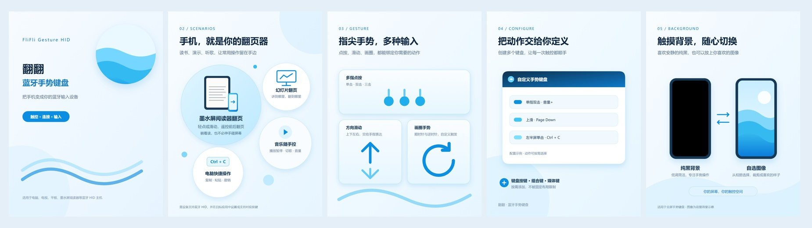

# 翻翻 · 蓝牙手势键盘

把 Android 手机变成可自定义的蓝牙遥控键盘。用点按、滑动或画圈控制另一台设备，轻松完成阅读器翻页、幻灯片翻页、音乐控制和电脑快捷操作。

**[下载最新版](https://github.com/Shalloater/FliFli-Gesture-HID/releases/latest)** · [更新记录](docs/CHANGELOG.md) · [反馈问题](https://github.com/Shalloater/FliFli-Gesture-HID/issues)

上图为功能示意。[查看更多介绍](promo/README.md)。

## 可以做什么

- **手势键盘**：把单指、双指或三指的点按和滑动，以及单指画圈，设置为你需要的操作。
- **电脑键盘**：直接点击屏幕上的键盘按键，发送字母、方向键和常用快捷键。
- **触控透传**：在手机上单指点击、长按、拖动或滑动，按比例控制另一台设备的屏幕。
- **自定义信号**：一个手势可以发送单个按键、组合键，或依次执行一串操作。
- **动画演示**：动作和触控信号配有示意缩略图，长按即可查看操作演示，支持暂停、重播和调整速度。
- **个性化设置**：创建多个键盘，分别设置名称、横竖屏、振动及纯黑或自选图片背景；支持五种皮肤和简体中文、繁体中文、英文、日语、韩语。

## 下载与连接

手机需要 **Android 9.0 或以上**，并支持蓝牙键盘设备功能。受控设备需要支持连接蓝牙键盘；触控和部分系统操作的效果取决于它的系统与应用。

1. 打开[下载页面](https://github.com/Shalloater/FliFli-Gesture-HID/releases/latest)，在 **Assets（附件）** 中下载 `FliFli-v版本号.apk`，安装到用来操作的 Android 手机上。
2. 打开 App，开启蓝牙，并按提示授予蓝牙或“附近设备”权限。
3. 在受控设备的蓝牙设置中搜索手机，完成配对。
4. 回到 App 的「连接」页，选择受控设备建立连接。
5. 在「首页」启动键盘。首次使用可先试试预置的「阅读器翻页」，再按阅读软件需要修改按键。

升级时直接覆盖安装即可保留已有键盘配置。**从 1.5.4 等早于 1.5.6 的版本升级后，请在两端删除旧蓝牙配对，再重新配对。**

## 设置自己的手势

进入「设置」，新增一个手势键盘，或点击已有键盘进行编辑。

1. 点击「新增动作」，通过「点按」「滑动」标签选择手势。点按可设置手指数、点击次数和生效区域；滑动可选择手指数及方向，也可选择单指画圈。
2. 选择要发送的信号，再点击「完成」。
3. 在键盘编辑页点击「完成」保存，然后回到首页启动。

点击已有动作，可以同时修改「触发手势」和「发送信号」；更换手势会保留当前信号，取消或返回则保留原来的设置。同类点按动作的区域不能重叠，例如左半屏单击和上半屏单击不能同时设置。

不确定手势怎么做，或触控信号会怎样滑动时，**长按对应条目查看演示**。

### 选择要发送的信号

| 分类 | 常见操作 |
| --- | --- |
| 键盘按键 | 字母、方向键、Page Up / Page Down、Ctrl、Win 等 |
| Android 控制 | 返回、主屏幕、音量+、音量-、电源等 |
| 媒体控制 | 播放/暂停、上一曲、下一曲、音量+、音量-等 |
| 触控手势 | 屏幕中心单击/双击、四向滑动，以及顶部、底部和左右边缘滑动，共 18 种 |

发送模式可以选择：

- **单个信号**：一次发送一个操作，点击新信号会替换原选择。
- **组合信号**：多个按键同时按下。例如选择「组合信号」，依次点 `Ctrl`、`C`，再点「完成」，即可设置 `Ctrl + C`。
- **信号序列**：触发一次，按顺序执行多个步骤，例如 `Ctrl + C → Tab → Ctrl + V`。点击「＋下一步」添加步骤，每一步都可使用单键或组合键，并可调整步骤间隔，最多 16 步。

触控手势可以单独发送，也可以放入信号序列；它在受控设备上对应的功能，由设备和应用的手势设置决定。

## 使用触控透传

在「设置」中新增「触控透传」键盘，设置方向和背景，再从首页启动。它会把手机上的**单指**点击、双击、长按、拖动和滑动映射到受控屏幕。

默认显示一个尽量大的 **3:4 安全触控区**，帮助避开手机自身的顶部、底部系统手势。框内对应受控设备的完整屏幕；可以从框外开始滑动，轨迹进入边界时才开始控制，入框位置就是受控屏幕上的起点。

建议两端使用相同的屏幕方向。触控透传不会显示受控设备的画面；屏幕比例不同，移动轨迹也会相应拉伸。当前仅支持单指透传，双指缩放或旋转不可用。

## 全屏操作与退出

**所有全屏键盘都可以双指向内捏合退出。**

触控透传支持全屏防误触，但手机系统的通知栏、主页等手势仍可能生效。如果需要进一步防止误触 Home，可以在触控透传设置中开启「屏幕固定保护」，进入时按系统提示确认。

如果解除固定后出现锁屏，请检查手机系统的屏幕固定设置，关闭「解除固定时锁定设备」或「取消固定前要求解锁」（名称因系统而异）。

## 常见问题

**已连接，为什么没有反应？**

先尝试方向键或 Page Up / Page Down，并确认受控应用支持这些按键。蓝牙连接成功不代表所有系统操作都受支持；阅读器可能还需要在阅读软件中设置按键或手势。更新后触控无反应时，可在两端删除旧配对后重新连接。

**可以连接哪些设备？**

可用于支持蓝牙键盘的电脑、Android 手机、平板、电视或阅读器。不同设备支持的按键和触控功能有所区别，iPad 等设备的触控兼容性需要实际测试。普通蓝牙音箱无法接收这类操作。

**双击会比单击慢一点吗？**

同一区域同时设置单击与双击时，App 需要短暂等待，才能判断是否还有下一次点击。只需要快速单击时，可以只设置单击动作。

遇到问题可到 [GitHub Issues](https://github.com/Shalloater/FliFli-Gesture-HID/issues) 反馈，请附上手机型号与系统版本、受控设备型号、App 版本，以及出现问题时的操作步骤。
